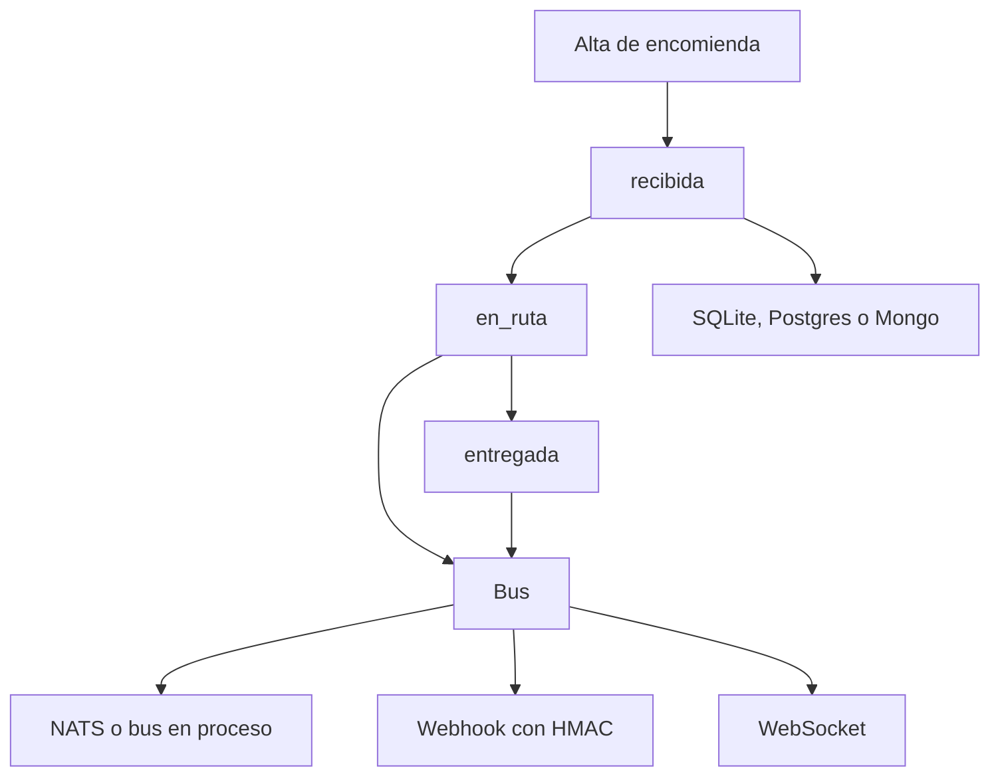

# Muelle

El seguimiento de una encomienda. Solo avanza en orden: recibida, en ruta, entregada. Cada paso avisa a quien sigue el envío y a los webhooks firmados.

## Concepto

El dominio no salta estados ni reabre una entrega. Al avanzar, el servicio publica un evento. El bus lo reparte: un webhook con HMAC y una sala de WebSocket. Sin NATS, Postgres ni Mongo el proceso usa SQLite y un bus en memoria, que es lo que cubren las pruebas.

## Stack

| Pieza | Para qué |
| --- | --- |
| NestJS | HTTP, el módulo y el ciclo de la app. |
| NATS | `NatsBus` si existe `NATS_URL`. Si no, un bus en proceso. |
| Webhooks | `Despachador`, firma en `x-anden-firma`. |
| Gateway | Socket.IO, evento `seguir`. |
| PostgreSQL | Adaptador con `POSTGRES_URL`. |
| MongoDB | Bitácora de entregas con `MONGO_URL`. |
| SQLite | Adaptador por defecto, `node:sqlite`. |
| Docker y Compose | API, NATS, Postgres y Mongo. |
| Kubernetes | `k8s/deployment.yaml`. |
| Google Cloud Build | `cloudbuild.yaml`. |
| Git submodule | `contracts/` es el contrato de eventos, listo para extraerse. |
| CI | `npm test` en el workflow del conjunto. |

## Flujo



## Correr

Desde esta carpeta:

```bash
npm ci
npm test
npm start
```

Escucha en el puerto `3041`. El mapa completo del clúster está en el proyecto de plataforma Kubernetes.
